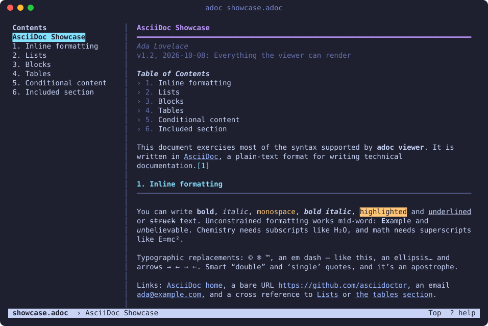
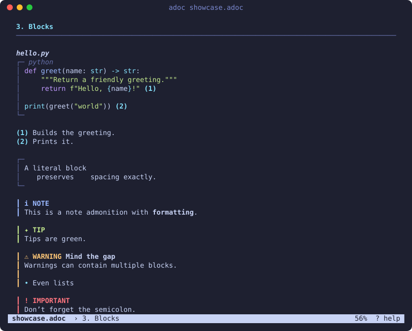

= adoc: AsciiDoc in your terminal
:toc: macro
:toclevels: 2
:experimental:
:repo: https://github.com/danielrezny/adoc-viewer
ifdef::env-github[]
:tip-caption: :bulb:
:note-caption: :information_source:
:important-caption: :heavy_exclamation_mark:
:warning-caption: :warning:
endif::[]

`adoc` renders https://asciidoc.org[AsciiDoc] documents in the terminal, the
way https://github.com/charmbracelet/glow[glow] and leaf do for Markdown. It
opens a full-screen pager with a table of contents, search, live reload and
mouse support, or prints the rendered document straight to stdout.

It is a single pure-Python package with no required dependencies.

toc::[]

== Install

You need Python 3.9 or newer on macOS or Linux (on Windows, use WSL).
https://pygments.org[Pygments] is optional and adds syntax highlighting to
source blocks; the `highlight` extra installs it.

The package is not on PyPI yet, so install it from GitHub.

With https://docs.astral.sh/uv/[uv] (recommended):

[source,sh,subs=attributes]
----
uv tool install 'adoc-viewer[highlight] @ git+{repo}'
----

With https://pipx.pypa.io[pipx]:

[source,sh,subs=attributes]
----
pipx install 'adoc-viewer[highlight] @ git+{repo}'
----

Both put an `adoc` command on your `PATH`. To upgrade later, run
`uv tool upgrade adoc-viewer` or `pipx upgrade adoc-viewer`.

[IMPORTANT]
====
The package is called `adoc-viewer`; only the command is `adoc`.
`uv tool install adoc` or `pip install adoc` would install an unrelated
package from PyPI.
====

=== From a clone

[source,sh,subs=attributes]
----
git clone {repo}.git
cd adoc-viewer
uv tool install '.[highlight]'      # or: pipx install '.[highlight]'
----

Or run it straight from the clone without installing anything:

[source,sh]
----
python3 -m adocview README.adoc
----

== Usage

[source,sh]
----
adoc README.adoc                 # open the viewer
adoc -p README.adoc              # print to stdout instead
adoc -p README.adoc | less -R    # print, then page with less
cat doc.adoc | adoc              # read from stdin
adoc -a product=Foo doc.adoc     # set a document attribute
adoc -w 100 doc.adoc             # narrower text column (default: the whole window)
adoc -f 18 doc.adoc              # bigger font while viewing (Apple Terminal)
adoc --no-mouse doc.adoc         # leave the mouse to the terminal
----

When the output is not a terminal, `adoc` prints instead of opening the
viewer, so it works in pipes. `--color always|never` controls colors when
printing; without colors, link targets are written out after the link text.

Press kbd:[?] in the viewer to see every key.

=== Keys

[cols="2,5"]
|===
|Key |Action

2+h|Moving around
|kbd:[j] / kbd:[k], arrows |Scroll a line
|kbd:[Space] / kbd:[b], kbd:[PgDn] / kbd:[PgUp] |Scroll a page
|kbd:[d] / kbd:[u] |Scroll half a page
|kbd:[g] / kbd:[G] |Top / bottom
|kbd:[\]] / kbd:[[] |Next / previous section
|kbd:[t] |Table of contents; kbd:[Tab] moves the focus into it

2+h|Searching
|kbd:[/] or kbd:[Ctrl+F] |Search box. It searches as you type; kbd:[Enter] or kbd:[↓] goes to the next match, kbd:[↑] to the previous one, kbd:[Esc] closes it
|kbd:[n] / kbd:[N] |Next / previous match once the box is closed
|kbd:[Esc] |Clear the search highlights

2+h|Copying
|kbd:[v], then kbd:[j] / kbd:[k] |Select whole lines
|kbd:[y] or kbd:[Enter] |Copy the selection to the clipboard
|kbd:[m] |Mouse capture on / off

2+h|View
|kbd:[w] |Whole window width / narrower column
|kbd:[+] / kbd:[-], kbd:[0] |Bigger / smaller font, original size
|kbd:[e] |Edit the file in your terminal editor
|kbd:[r] |Reload (also happens automatically when a file changes)
|kbd:[q] |Quit
|===

=== Mouse and copying text

The viewer captures the mouse: the wheel scrolls, and you can click entries in
the table of contents, cross references, and links (they open in your browser).
To select text with the mouse anyway, hold a modifier key while dragging:
kbd:[fn] in Apple Terminal, kbd:[⌥] in iTerm2, kbd:[Shift] in most other
terminals. kbd:[m] or `--no-mouse` gives the mouse back to the terminal; a
plain drag then selects, but some terminals (Apple Terminal included) stop
scrolling with the wheel.

To copy with the keyboard, press kbd:[v], extend the selection with kbd:[j] /
kbd:[k] or the page keys, and press kbd:[y]. The copied text leaves out
code-block frames, quote and admonition bars, and trailing spaces, so a
selected source block pastes as plain code. Copying uses `pbcopy`, `wl-copy`,
`xclip` or `xsel`, and falls back to asking the terminal (OSC 52).

=== Editing

kbd:[e] opens the document in your terminal editor: the one named by
`$VISUAL`, otherwise `$EDITOR`, otherwise `vi`. The viewer steps aside while
the editor runs and shows the saved changes when you quit it. The editor
starts at the top of the file, not at the part you were reading. To use
another editor, set the variable in your shell profile:

[source,sh]
----
export EDITOR=nano          # or vim, nvim, hx, micro, ...
export VISUAL="code --wait" # a GUI editor must wait until the file is closed
----

Editing is not available when the document comes from stdin.

=== Font size

Terminals don't let programs change the font through escape sequences. In
Apple Terminal, `adoc` asks Terminal through AppleScript instead: only its own
tab changes, the window keeps its size so the text reflows, and the original
size comes back when you quit. The first time, macOS asks whether Terminal may
control Terminal. In other terminals, kbd:[+] reminds you of the terminal's
own zoom keys, usually `⌘+` and `⌘-` on macOS. The viewer reflows
to the new size either way.

== What it renders

Text::
Bold, italic, monospace, highlight, underline and strike-through;
sub- and superscript; typographic quotes, dashes, arrows and symbols; links,
cross references and footnotes. Links are clickable in terminals that support
OSC 8 hyperlinks.

Structure::
The document header (title, author, revision), sections with optional
numbering (`:sectnums:`), a table of contents (`:toc:`), discrete headings,
appendices and thematic breaks.

Lists::
Bulleted, numbered (with nested numbering styles), checklists, description
lists (including `[horizontal]`), callout lists, and list continuation with
`+`.

Blocks::
Source blocks with syntax highlighting, callouts and `linenums`; literal,
quote, verse, sidebar, example, open and passthrough blocks; the five
admonition types as paragraphs or blocks; block titles and anchors.

Tables::
Column specs with widths and alignment, header and footer rows, column spans,
cell styles, AsciiDoc cells (`a|`), and CSV/DSV data. Columns are sized to fit
the window.

Attributes and includes::
Document attributes and `{name}` references (also from `-a`), counters,
`include::` with `lines=`, `tag=`/`tags=`, `leveloffset=` and `indent=`, and
`ifdef`, `ifndef` and `ifeval`. The viewer reloads when the document or any
included file changes.

Status placeholders::
`\{yes}` ✅, `\{no}` ❌, `\{partial}` 🟡, `\{maybe}` ❓, `\{na}` ➖, `\{wip}` 🚧,
`\{todo}` 📝 and a few more are shown as emoji, which is handy in comparison
tables. A document's own definition of these names wins.

=== Limitations

`adoc` is a viewer, not a complete AsciiDoc implementation. In particular:

* Images are shown as a placeholder with their alt text and path.
* Cells that span several rows are laid out as if they spanned one.
* Two-line (underlined) section titles from older AsciiDoc are not recognized.

If a document renders wrongly, please open an issue with a small sample.

== Development

[source,sh]
----
git clone https://github.com/danielrezny/adoc-viewer.git
cd adoc-viewer
uv run --no-project --with pytest --with pygments python -m pytest tests
python3 -m adocview examples/showcase.adoc
----

`examples/showcase.adoc` exercises most of the supported syntax and is the
quickest way to see the effect of a change. The screenshots in this README are
generated from it:

[source,sh]
----
uv run --no-project --with pyte --with pygments python scripts/screenshot.py \
    docs/screenshot.svg examples/showcase.adoc --keys t
----

How the code is laid out, in the order a document flows through it:

[horizontal]
`preprocess.py`:: includes and conditionals
`parser.py`:: block parser producing a small document tree
`inline.py`:: inline markup to styled text segments
`render.py`:: the tree to wrapped, styled lines for a given width
`tui.py`:: the full-screen viewer (raw ANSI, no curses)
`cli.py`:: command-line options, and print mode

== License

MIT. See link:LICENSE[].
